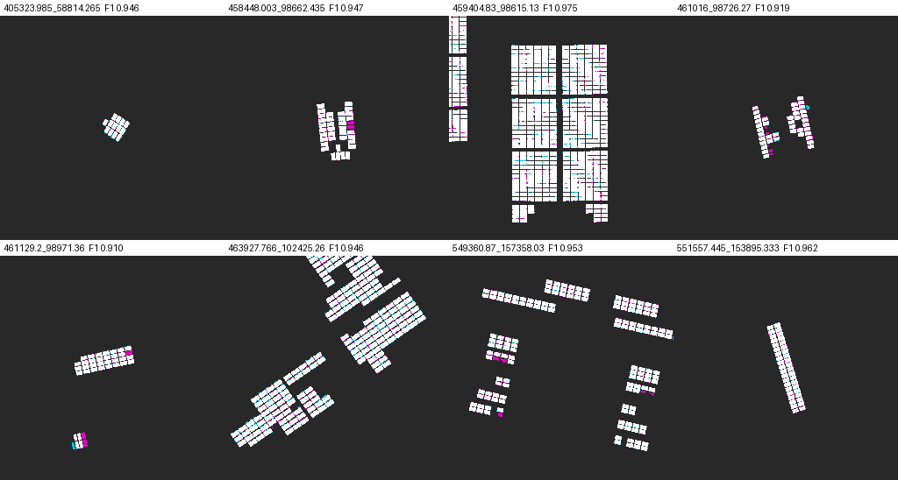

# GeoSeg-PV

Detection of individual photovoltaic (PV) modules in very high resolution (VHR) satellite imagery.

GeoSeg-PV is a fork of [GeoSeg](https://github.com/WangLibo1995/GeoSeg) by Libo Wang (its README is kept as [README_GeoSeg.md](README_GeoSeg.md)). It adds a binary PV module segmentation task to GeoSeg: the dataset loader, 20 configurations (10 networks, each with and without a Fine Optimization Module), released weights and tools for inference and evaluation. It is the reference implementation of the module detection in

> N. Lukač, S. Seme, K. Sredenšek, G. Štumberger, D. Mongus, B. Žalik, M. Bizjak. **Detection and Optimization of Photovoltaic Arrays' Tilt Angles Using Remote Sensing Data.** *Applied Sciences* 15(7), 3598, 2025. https://doi.org/10.3390/app15073598



*FT-UNetFormer + FOM on the test tiles of split 0 (white: detected PV, magenta: false detections, cyan: missed PV). The imagery is not shown because it may not be redistributed. See [Example](#example).*

## Models

All networks predict two classes (0 = PV, 1 = background) for 512 × 512 RGB patches. Optionally the logits are refined by a Fine Optimization Module (FOM), a small U-shaped network after PVNet (Wang et al., 2023) in [geoseg/models/FineOptimizationModule.py](geoseg/models/FineOptimizationModule.py). F1 and IoU are those of the PV class on the test tiles, as the mean of five random splits (± standard deviation over the splits).

| Network | Encoder | Parameters [M] | F1 −FOM | IoU −FOM | F1 +FOM | IoU +FOM | Config |
|---|---|---|---|---|---|---|---|
| BANet | ResT-Lite | 12.7 | 0.927 ± 0.018 | 0.864 ± 0.031 | 0.937 ± 0.015 | 0.882 ± 0.026 | `banet` |
| A2-FPN | ResNet-18 | 12.2 | 0.898 ± 0.005 | 0.815 ± 0.009 | 0.934 ± 0.010 | 0.876 ± 0.018 | `a2fpn` |
| MANet | ResNet-18 | 12.0 | 0.922\* | 0.855\* | 0.941 ± 0.007 | 0.889 ± 0.012 | `manet_r18` |
| MANet | EfficientNet-B5 | 28.0 | 0.942\* | 0.890\* | 0.949 ± 0.010 | 0.904 ± 0.019 | `manet_effb5` |
| MANet | SE-ResNeXt26d-32x4d | 27.1 | 0.947\* | 0.900\* | 0.948 ± 0.010 | 0.901 ± 0.018 | `manet_seresnext26d` |
| DCSwin | Swin-S | 66.9 | 0.899 ± 0.005 | 0.817 ± 0.008 | 0.934 ± 0.009 | 0.876 ± 0.015 | `dcswin` |
| UNetFormer | ResNet-18 | 11.7 | 0.905 ± 0.007 | 0.827 ± 0.012 | 0.939 ± 0.012 | 0.886 ± 0.022 | `unetformer_r18` |
| UNetFormer | EfficientNet-B5 | 27.8 | 0.914 ± 0.005 | 0.842 ± 0.009 | 0.948 ± 0.008 | 0.901 ± 0.014 | `unetformer_effb5` |
| UNetFormer | SE-ResNeXt26d-32x4d | 15.5 | 0.911 ± 0.007 | 0.837 ± 0.012 | 0.942 ± 0.018 | 0.891 ± 0.031 | `unetformer_seresnext26d` |
| **FT-UNetFormer** | Swin-B | 96.0 | 0.915 ± 0.006 | 0.843 ± 0.011 | **0.952 ± 0.008** | **0.908 ± 0.014** | `ftunetformer` |

The FOM adds 0.41 M parameters. The config of a network with FOM has the suffix `_fom` (e.g. `config/pv/ftunetformer_fom.py`).

Released weights: 5 per configuration (one per split), as `<config>/fold<k>.safetensors`, for all configurations except MANet without FOM (\*: these values are from the paper, the weights were not kept). Every released file was re-evaluated and gives the published test result of its split. Hugging Face: *link will be added*.

## Install

```bash
pip install torch torchvision --index-url https://download.pytorch.org/whl/cu126
pip install -r requirements.txt
```

Tested with Python 3.11, PyTorch 2.11 (CUDA 12.6), timm 0.9.2, pytorch-lightning 2.4.0 and albumentations 1.4.13 on Windows 11. Run all commands from the repository folder. Training additionally needs the ImageNet weights of the Swin and ResT backbones in `pretrain_weights/` (see [README_GeoSeg.md](README_GeoSeg.md#pretrained-weights-of-backbones)). Inference with released weights does not.

## Detect PV modules in your images

```bash
python pv_inference.py -i image.tif -w ftunetformer_fom/fold0.safetensors -o output --prob
```

- Input: 8-bit RGB GeoTIFF, PNG or JPEG of any size. It is processed in 512 × 512 patches with 128 pixels overlap, and overlapping predictions are blended.
- Output: `<name>_pv.tif` (PV = 255) on the grid of the input, and with `--prob` the PV probability (0 to 255). Plain images give PNG.
- Several `-w` files are averaged (an ensemble, e.g. the five splits of one configuration).
- The models were trained on Google satellite imagery resampled to a ground sampling distance (GSD) of about 0.1 m (0.096 to 0.099 m). For a georeferenced input with another GSD, `--gsd 0.1` resamples it before prediction.

In Python:

```python
from geoseg.pv import load_model, predict_proba
model = load_model('ftunetformer_fom/fold0.safetensors', device='cuda')
pv = predict_proba(model, rgb, device='cuda') >= 0.5  # rgb: uint8 array (H, W, 3)
```

## Ground truth

The ground truth has 80 tiles over Slovenia with individual modules annotated on Google satellite imagery (zoom level 20, downloaded in July 2023). It is published as masks only, together with the extent of every tile and a script that rebuilds the matching RGB patches (`get_rgb.py`, e.g. through the Google Maps Platform Map Tiles API with your own key). Zenodo: *DOI will be added*. Its README describes the format.

The masks cover the central 512 × 512 pixels of each tile image after it was resized to 1024 × 1024, about 50 × 50 m on the ground at a GSD of 0.096 to 0.099 m. `splits.json` holds the five random train/val/test splits of 60/12/8 tiles used for the results above.

## Example

The example reproduces the result of FT-UNetFormer + FOM on the 8 test tiles of split 0.

```bash
python <ground_truth>/get_rgb.py google --key YOUR_KEY --fold 0 --part test --out example/images
python example/run_example.py --gt <ground_truth> --images example/images -w <models>/ftunetformer_fom/fold0.safetensors
```

It writes an error map per tile, [example/output/overview.png](example/output/overview.png) and [example/output/results.txt](example/output/results.txt) (F1 0.9585, IoU 0.9203 over the 8 tiles with the original imagery). The imagery Google serves today may be newer than the imagery the masks were drawn on, so your result can differ where roofs have changed.

## Training and testing

1. Rebuild the RGB patches of all tiles (`get_rgb.py`) and write the patches of the five splits:
   ```bash
   python tools/pv_patch_split.py --gt <ground_truth> --images <ground_truth>/images --out data/pv
   ```
   This gives `data/pv/fold<k>/{train,val,test}/{images_512,masks_512}`. The training tiles are added flipped horizontally and vertically, as in the paper.
2. Train a configuration on split `k` (environment variable `PV_FOLD`, default 0):
   ```bash
   PV_FOLD=0 python train_supervision.py -c config/pv/ftunetformer_fom.py
   ```
   In PowerShell: `$env:PV_FOLD=0; python train_supervision.py -c config/pv/ftunetformer_fom.py`. All configurations use AdamW (learning rate 1e-4, weight decay 2.5e-4) with Lookahead, cosine annealing with warm restarts (T0 = 30 epochs), batch size 4, at most 200 epochs with early stopping after 20 epochs without improvement of the validation F1, and the joint soft cross-entropy and Dice loss (UNetFormer: with its auxiliary head). Checkpoints are written to `model_weights/pv/fold<k>/<config>/`.
3. Test it:
   ```bash
   PV_FOLD=0 python pv_test.py -c config/pv/ftunetformer_fom.py -o fig_results/pv/ftunetformer_fom
   python pv_test.py -w <models>/ftunetformer_fom/fold0.safetensors --data data/pv/fold0/test
   ```
   `--per-image` adds the scores of every tile, `-t lr` or `-t d4` test-time augmentation.
4. Export the weights for `geoseg.pv.load_model`:
   ```bash
   python -m tools.pv_export model_weights/pv/fold0/ftunetformer_fom/ftunetformer_fom.ckpt ftunetformer_fom_fold0.safetensors --arch ftunetformer --fom
   ```

## Changes to GeoSeg

| File | Change |
|---|---|
| `geoseg/models/FineOptimizationModule.py` | New: FOM |
| `geoseg/models/{UNetFormer,FTUNetFormer,DCSwin,BANet,A2FPN,MANet}.py` | Optional FOM (`fom=True`); A2FPN can be built without ImageNet weights (`pretrained=False`) |
| `geoseg/datasets/pv_dataset.py` | New: PV dataset (binary masks, PV = label 0) |
| `geoseg/pv.py` | New: the 10 networks by name, loading of released weights, tiled prediction |
| `config/pv/` | New: the 20 configurations |
| `train_supervision.py` | PV metrics (PV class only), optional early stopping (`early_stopping_patience` in a config) |
| `tools/metric.py` | F1 is 0 instead of NaN for a class that is never predicted |
| `tools/utils.py` | `collections.abc.Mapping` (Python 3.10+) |
| `tools/pv_patch_split.py`, `tools/pv_export.py`, `pv_test.py`, `pv_inference.py`, `example/` | New |

## Limitations

- The training tiles cover 80 PV systems in Slovenia in Google imagery. Other imagery may need fine-tuning. On a 2022 aerial true orthophoto of Maribor, where the modules appear bright instead of dark, FT-UNetFormer + FOM detected no modules at all.
- The masks annotate modules, not arrays or systems, and only the central part of each tile.
- Skylights, glass roofs and other dark rectangular surfaces can be detected as PV, and modules with non-uniform colour can be partly missed (see Fig. 5 of the paper).

## Citation

If you use the code, the models or the ground truth, please cite:

```bibtex
@article{lukac2025pv,
  author  = {Luka{\v{c}}, Niko and Seme, Sebastijan and Sreden{\v{s}}ek, Klemen and {\v{S}}tumberger, Gorazd and Mongus, Domen and {\v{Z}}alik, Borut and Bizjak, Marko},
  title   = {Detection and Optimization of Photovoltaic Arrays' Tilt Angles Using Remote Sensing Data},
  journal = {Applied Sciences},
  volume  = {15},
  number  = {7},
  pages   = {3598},
  year    = {2025},
  doi     = {10.3390/app15073598}
}

@article{lukac2013rating,
  author  = {Luka{\v{c}}, Niko and {\v{Z}}laus, Danijel and Seme, Sebastijan and {\v{Z}}alik, Borut and {\v{S}}tumberger, Gorazd},
  title   = {Rating of roofs' surfaces regarding their solar potential and suitability for {PV} systems, based on {LiDAR} data},
  journal = {Applied Energy},
  volume  = {102},
  pages   = {803--812},
  year    = {2013},
  doi     = {10.1016/j.apenergy.2012.08.042}
}
```

Please also cite GeoSeg (L. Wang et al., UNetFormer: A UNet-like transformer for efficient semantic segmentation of remote sensing urban scene imagery, *ISPRS Journal of Photogrammetry and Remote Sensing* 190, 196–214, 2022, https://doi.org/10.1016/j.isprsjprs.2022.06.008) and the paper of the network you use. The FOM follows J. Wang et al., PVNet: A novel semantic segmentation model for extracting high-quality photovoltaic panels in large-scale systems from high-resolution remote sensing imagery, *International Journal of Applied Earth Observation and Geoinformation* 119, 103309, 2023.

## Acknowledgements

This work was carried out at the University of Maribor, Faculty of Electrical Engineering and Computer Science, and funded by the Slovenian Research and Innovation Agency (ARIS): research project J7-50095 and research core funding P2-0041 and P2-0115. We thank Libo Wang for GeoSeg, and Google, Airbus, CNES/Airbus and Maxar Technologies for the satellite imagery.

## License

[GNU General Public License v3.0](LICENSE), as GeoSeg.
